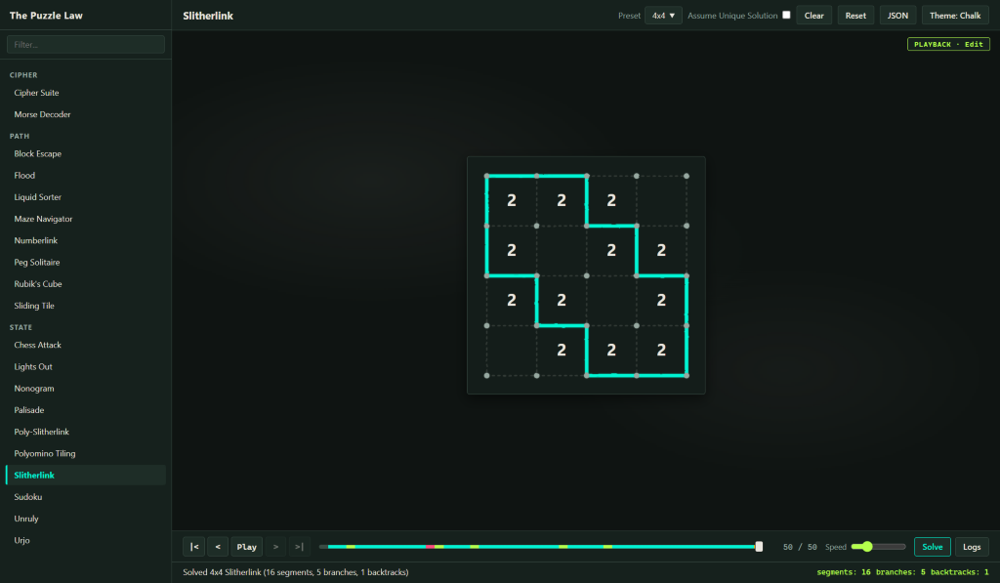
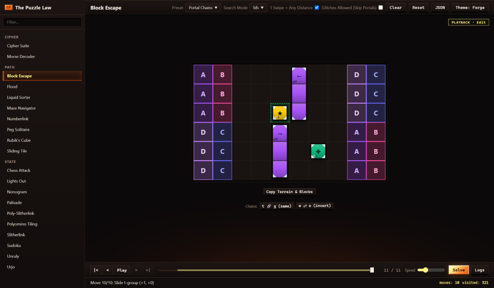
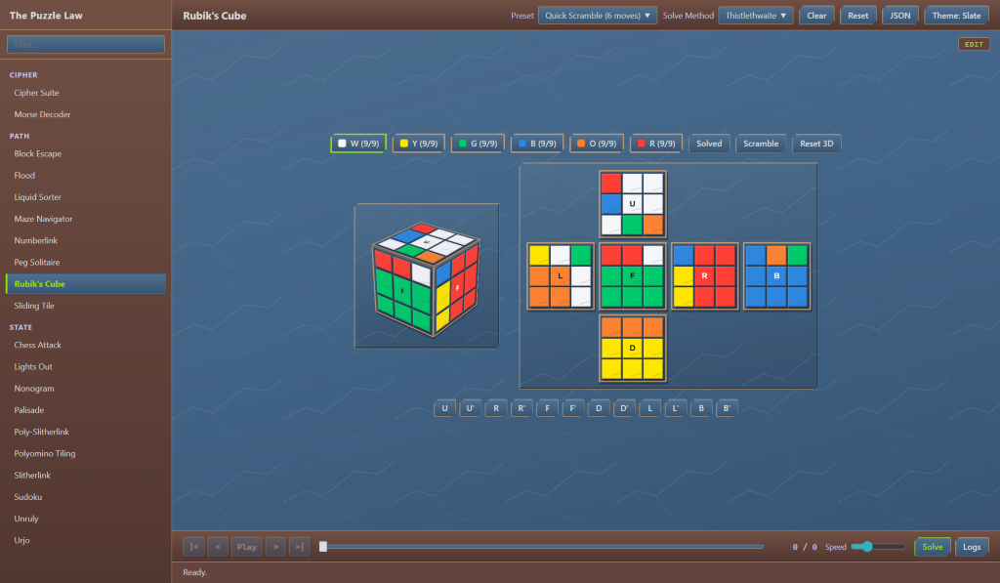
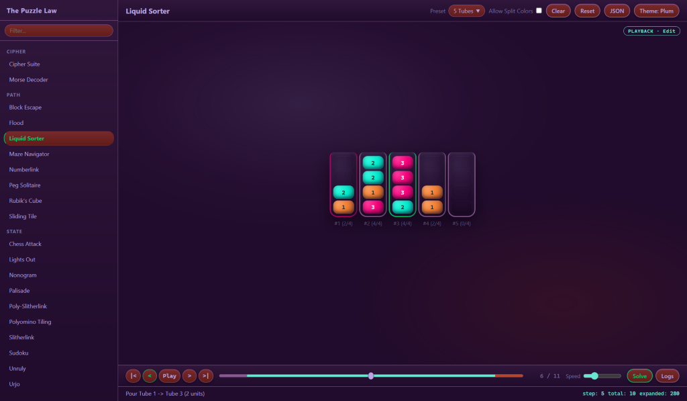
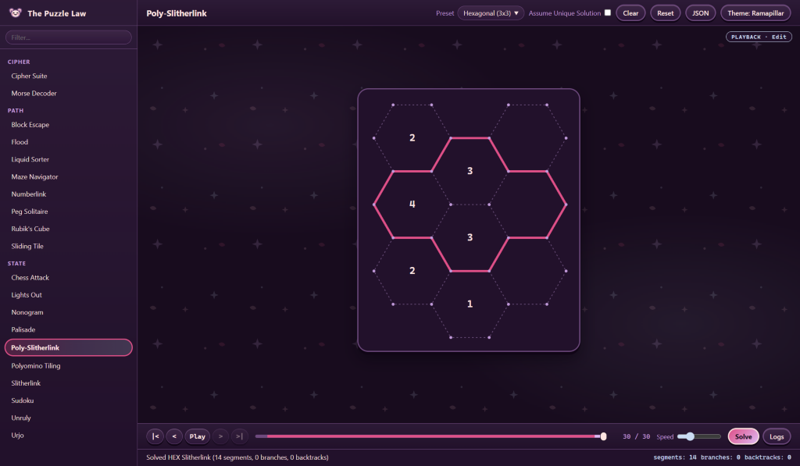

# The Puzzle Law

[](https://www.python.org/)
[](https://docs.astral.sh/uv/)
[](LICENSE)

**A local-first puzzle & cipher workbench that runs in your browser.**  
Pick a puzzle, sketch or tweak a board straight on the page (or load a preset), hit **Solve**, and scrub through every deduction, branch, and move step-by-step.

No cloud calls, no accounts, no frontend build step. Just Python + a browser tab.

---

## Try It

```bash
uv sync
uv run python -m app.main
```

Opens `http://127.0.0.1:8000` in your browser.  
Pass `--no-browser` or `--port 8080` if you want to keep it headless or move the port.

---

## Themes

Cycle themes anytime from the top bar (**Theme** button) or via URL (`?theme=forge`). Each theme changes the surface material, stroke style, and board geometry—not just the colors.

| Chalk | ChromaForge |
| :---: | :---: |
|  |  |
| **Electric Slate** | **Midnight Plum** |
|  |  |

| Ramapillar |
| :---: |
|  |

---

## What's Inside

- **Path Puzzles**: Block Escape (merged pieces, ice, portals, lockstep chains), Flood, Liquid Sorter, Maze Navigator (square & hex, edge walls, weighted terrain), Numberlink, Peg Solitaire, Rubik's Cube, Sliding Tile.
- **Logic & Grid Puzzles**: Chess Attack (Queens & Rook+King), Lights Out, Nonogram, Palisade, Polyomino Tiling, Slitherlink, Poly-Slitherlink (Square, Hex, Triangular, 3-4-6-4), Sudoku, Unruly, Urjo.
- **Ciphers & Signals**: Cipher Suite (Caesar/ROT, Atbash, Vigenère, Base64/Hex/Binary, frequency bars) and Morse Decoder (spaced, phonetic, binary, and unspaced/smooshed streams).
- **Live Playback**: Pause, step forward/back, scrub the color-coded timeline (deductions, explorations, backtracks, solution), or inspect/edit any board as raw JSON.

---

## Customization

### Tweak or Add a Theme
All five themes live in [web/styles.css](web/styles.css) under `:root[data-theme="<id>"]`, with optional SVG stroke/shading filters in [web/index.html](web/index.html).

1. Copy an existing `:root[data-theme="..."]` block in [web/styles.css](web/styles.css) and tune its palette, `--frame-bg`, `--stage-tex`, `--tile-shade`, and radii.
2. Add `{ id: "your_id", label: "Theme: Your Name" }` to `THEMES` in [web/app.js](web/app.js).
3. Refresh the browser—your theme selection persists in `localStorage` and updates the tab favicon automatically.

### Add Your Own Puzzle
Every puzzle is a single self-contained file in `solvers/`—no config registration needed. Drop a `.py` file with `META` and a generator `solve(state, params, should_abort)` that yields step dicts (`"start"` → `"deduce"` / `"explore"` / `"backtrack"` → `"solution"` or `"failed"`), and it shows up in the sidebar on startup.

*(Developer guidelines and test rules live in [AGENTS.md](AGENTS.md). Legacy PySide6 desktop code is archived on branch `legacy/pyside6` / tag `v1-pyside6`.)*
