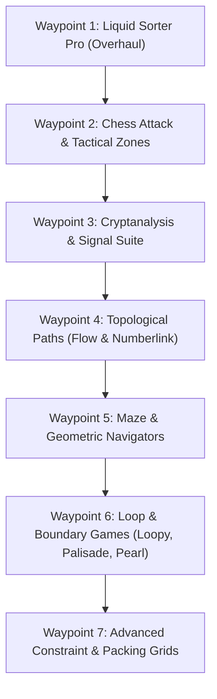

# The Puzzle Law: Waypoint Implementation Plan

This document establishes the granular implementation blueprint for each successive puzzle engine in **The Puzzle Law (`solvertools_hub`)**. It details the mathematical model, data structures, solver algorithms, UI/canvas ergonomics, and verification criteria for each milestone.

---

## Architecture Context & Foundation

All modules implement the four core contracts established in `solvertools_hub.core`:
* **`BasePuzzleState`**: `clone()`, `serialize() -> str`, `deserialize(str) -> State`, `validate() -> (bool, str)`.
* **`BaseSolver`**: Generator yielding `SolverStep(state, action_desc, highlights, metrics)`. Supports both **Timeline Playback** and **Instant Solve**.
* **`BasePuzzleCanvas`**: `QPainter` widget with `EDIT` (transcription) and `PLAYBACK` (locked animation) modes.
* **`BasePuzzlePlugin`**: Metadata descriptor, factory methods, and optional `create_tool_strip()` toolbar.

---

---

# Waypoint 1: Liquid Sorter Pro (Overhaul) [COMPLETED]

### 1.1 Objective & Scope
Overhaul the reference `sand_tubes` plugin using the advanced engine from [`liquids_puzzle_solver.py`](file:///c:/Users/AlitheiaDeus/DeusLocker/L2C/The_Puzzle_Law/Snippets%20To%20Integrate/liquids_puzzle_solver.py). Upgraded with **per-tube variable capacities**, **split/duplicate color completions**, dynamic workbench canvas rendering, live feasibility detection, and an **$A^*$ PriorityQueue solver** with color-transition heuristic and symmetry breaking.

### 1.2 Mathematical Model & State Representation
* **State Attributes**:
  * `capacities: List[int]`: Array where `capacities[i]` is the maximum volume of tube $i$ (e.g. `[3, 5, 4, 4, 3]`).
  * `tubes: List[List[int]]`: List of stacks. Each stack contains color IDs from bottom ($0$) to top ($\text{len}-1$).
  * `allow_split_colors: bool`:
    * `False` (default): A color cannot be finished across multiple tubes (e.g., four red segments must all end in the same tube).
    * `True`: A color may be completed across multiple full tubes.
* **Validation Rules**:
  * Every tube $i$ must satisfy $0 \le \text{len}(\text{tubes}[i]) \le \text{capacities}[i]$.
  * At least two tubes; at least one empty or partial buffer tube.
  * Total segments of any color cannot exceed the sum of capacities.
* **Solved Condition**:
  * Every tube is either completely empty ($\text{len} = 0$) or completely full ($\text{len} = \text{capacities}[i]$) and monochrome ($\text{len}(\text{set}(\text{tube})) = 1$).

### 1.3 Solver Algorithm ($A^*$ with Homogeneity Heuristic)
* **Search Space**: Priority Queue ordered by $f(s) = g(s) + h(s)$.
* **Heuristic Function $h(s)$**:
  $$h(s) = \sum_{i} \text{color\_changes}(i) - \text{bonus} \times \text{completed\_monochrome\_tubes}(s)$$
  where $\text{color\_changes}(i)$ counts transitions between different colors in tube $i$.
* **Move Pruning & Branch Optimizations**:
  1. Contiguous block pours: If top $k$ segments share the same color, pour $\min(k, \text{space\_in\_dst})$.
  2. Skip pouring from an already completed full monochrome tube.
  3. Skip pouring a pure single-color partial tube into an empty tube (avoids infinite ping-pong cycles).
  4. Symmetry breaking: Do not branch into pouring into multiple identical empty tubes.

### 1.4 UI & Canvas Ergonomics
* **Dynamic Bottle Sizing**: Tube height on canvas is proportional to its individual capacity:
  $$\text{height}(i) = \text{base\_pad} + \text{capacities}[i] \times \text{segment\_height}$$
* **Tube Badge**: Chalk badge at the lip of each tube displaying current fill / max capacity (e.g., `3/5`).
* **Tool Strip**:
  * Tube capacity adjustment spinners per tube.
  * Pastel swatch palette.
  * Rule checkboxes: "Allow Split Colors", "Strict Pouring".
* **Click Actions**:
  * Left-Click: Push active color segment.
  * Right-Click: Pop top segment.
  * Middle-Click / Click-to-Pour: Select source tube, click destination tube to simulate real game pour.

---

# Waypoint 2: Chess Attack & Tactical Zoned Boards

### 2.1 Objective & Scope
Merge and modernize [`chess_attack_solver.py`](file:///c:/Users/AlitheiaDeus/DeusLocker/L2C/The_Puzzle_Law/Snippets%20To%20Integrate/chess_attack_solver.py) and [`superking_solver.py`](file:///c:/Users/AlitheiaDeus/DeusLocker/L2C/The_Puzzle_Law/Snippets%20To%20Integrate/superking_solver.py) into a unified tactical constraint solver. Supports **arbitrary zoned board painting**, **Extended King (Rook + King)**, **Queen**, **Super King**, and **custom user-defined attack masks**.

### 2.2 Piece Taxonomy
1. **Extended King ("Dragon King" / Promoted Rook)**:
   * Orthogonal ray moves at any distance (Rook): $(0, \pm k), (\pm k, 0)$.
   * Diagonal step moves of distance 1 (King): $(\pm 1, \pm 1)$.
2. **Queen**:
   * Orthogonal ray moves + Diagonal ray moves at any distance.
3. **Super King**:
   * Extended King + Knight jump moves $(\pm 1, \pm 2), (\pm 2, \pm 1)$.
4. **Custom Piece Matrix**:
   * $5 \times 5$ interactive offset grid allowing user to toggle custom attack vectors (e.g., Leapers, Camel, Bishop-only, etc.).

### 2.3 Mathematical Model & State Representation
* `board_size: int`: Board dimension $N \times N$ (default $8$, scalable $4$ to $16$).
* `zones: List[List[Tuple[int, int]]]`: Partition of cells into $N$ contiguous territorial zones.
* `board: List[List[int]]`: $0$ = Empty, $1$ = Piece placed.
* `deduction_map: List[List[int]]`:
  * $+1$: Confirmed piece placement.
  * $-1$: Deduced empty cell (cannot contain a piece).
  * $0$: Unassigned.
* **Constraints**:
  1. Exactly 1 piece per zone (or user-defined zone quota).
  2. Exactly 1 piece per row and column (standard $N$-piece non-attacking invariant).
  3. No piece may occupy an attacked cell of any other piece.

### 2.4 Solver Pipeline (Hybrid Deduction + Backtracking)
1. **Threat Heatmap Generator**:
   Computes `attack_count[r][c]` for all cells given current pieces.
2. **Deterministic Deductions**:
   * *Zone Overlap*: If all cells of a zone except one are attacked, the remaining cell MUST contain a piece.
   * *Row/Col Overlap*: If only one cell in a row/col is unattacked, place piece.
   * *Propagation*: Once a piece is placed, mark all attacked cells as `-1` (deduced empty).
3. **Backtracking Search**:
   * Selects zone with minimum remaining unattacked cells (MRV).
   * Attempts placements, propagating threat exclusions after each trial.

### 2.5 UI & Canvas Ergonomics
* **Zone Painter Mode**: Click and drag across the board with a pastel brush to create irregular territorial zones.
* **Live Threat Heatmap**: Soft neon coral overlays on cells that are currently attacked by placed pieces.
* **Glyph Rendering**: Chalkboard rendered Unicode chess glyphs (`♕`, `♔`, `♖`) with neon cyan selection borders.

---

# Waypoint 3: Cryptanalysis & Signal Suite ("The Cipher Room")

### 3.1 Objective & Scope
Implement a dedicated **"Crypt & Signal"** category directly inside `solvertools_hub`. It brings the high-performance unspaced Morse beam-search decoder from [`ascii_morse/`](file:///c:/Users/AlitheiaDeus/DeusLocker/L2C/The_Puzzle_Law/Snippets%20To%20Integrate/ascii_morse) and bundles classical ciphers, frequency analyzers, and an ARG transformation pipeline.

### 3.2 Modules Breakdown
* **3.1 Smooshed Morse Permutations**:
  * Input: Continuous unspaced dot/dash strings (e.g., `...---...` or `--.--.-...-`).
  * Trie indexing of ~16,400 English words (ENABLE1 + Google Web 1T).
  * Beam Search with unigram log-probabilities.
  * Single-letter filtering (only 'A' and 'I' allowed as standalone words to suppress $E/T$ noise).
  * Transformations: Normal, Inverted (`.` $\leftrightarrow$ `-`), Reversed, and Bookend Chops.
  * Multilingual Lexicons: English, German, French, Spanish, Russian Cyrillic, Japanese Wabun.
* **3.2 Classical Ciphers & Frequency Analysis**:
  * Caesar / ROT multi-wheel (simultaneously scores all 25 offsets against standard English letter frequencies via $\chi^2$ statistic).
  * Monoalphabetic Substitution: Interactive letter mapping table with live letter-frequency histogram.
  * Braille: 6-dot Grade 1 and Grade 2 transliteration.
* **3.3 ARG / "CyberChef" Pipeline Staging**:
  * Modular recipe pipeline: Base64, Hexadecimal, Binary, URL encode/decode, XOR bitmasking, Atbash.

---

# Waypoint 4: Topological Paths (Flow vs. Numberlink)

### 4.1 Modular Separation: Flow vs. Numberlink
| Feature | Flow Free (`plugins/flow/`) | Numberlink (`plugins/numberlink/`) |
| :--- | :--- | :--- |
| **Grid Coverage** | **100% Saturation required** (every cell must be part of a path) | **Sparse coverage allowed** (unvisited empty cells are legal) |
| **Edge Walls** | Supported (blocks adjacency between adjacent cells) | Typically standard open grid |
| **Corner Degree** | Corners with no endpoint MUST connect their 2 neighbors | Paths cannot have arbitrary unneeded bends |
| **Flood Fill Check** | Rejects any move that splits unvisited cells into isolated regions | Rejects cycles and cross-intersections |

### 4.2 Flow Free Engine Details ([`flow_solver.py`](file:///c:/Users/AlitheiaDeus/DeusLocker/L2C/The_Puzzle_Law/Snippets%20To%20Integrate/flow_solver.py))
* **Gates / Forced Moves Method**:
  * If an unvisited cell has only 2 available exits, the path MUST flow through them.
  * If an endpoint has only 1 available exit, it MUST move through it.
* **Region Connectivity (Flood Fill)**:
  * Whenever a path step is placed, run quick connected-component analysis on remaining empty cells. If an empty component contains no endpoints, the move is invalid (dead space).
* **QPainter Smooth Path Rendering**:
  * Renders paths using rounded `QPainterPath` splines centered on cells, color-coded with `ChalkTheme.PASTEL_PALETTE` and glowing neon active heads.

---

# Waypoint 5: Maze & Geometric Navigators

### 5.1 Module 5.1: Orthogonal 2D Grid Maze
* Left-click + drag paints chalk walls (`PASTEL_MINT`); Middle-click places Start (`PASTEL_SKY`) and Goal (`NEON_LIME`).
* Solvers: $A^*$ (Manhattan), Breadth-First Search, Dijkstra, Bidirectional $A^*$, and Dead-End Pruning.
* Live search tree streaming toggle (`stream_search=True`).

### 5.2 Module 5.2: Hexagonal Coordinate Maze
* Axial coordinates $(q, r)$ and Cube coordinates $(x, y, z)$ where $x + y + z = 0$.
* 6-directional hexagonal wall toggles.
* Hex-Manhattan distance heuristic:
  $$d(A, B) = \frac{|x_A - x_B| + |y_A - y_B| + |z_A - z_B|}{2}$$

### 5.3 Module 5.3: Freeform Euclidean 2D Navigator
* Continuous 2D plane with user-drawn polygonal chalk obstacles.
* Visibility Graph generation (connecting obstacle vertices that have clear line-of-sight).
* Continuous $A^*$ pathfinding + String-Pulling path smoothing algorithm.

---

# Waypoint 6: Loop & Boundary Games

### 6.1 Module 6.1: Slitherlink / Loopy
* **Lattice**: Grid of vertices with numerical clues ($0, 1, 2, 3$) in the cells.
* **Rule**: Connect adjacent vertices horizontally or vertically to form a **single non-self-intersecting closed loop**.
* **Deduction Engine**:
  * Vertex theorem: Every vertex has degree either $0$ or $2$.
  * Zero clue: All 4 surrounding edges are marked with `X`.
  * Adjacent threes: Center edge and outer parallel edges are forced lines.
  * Sub-loop prevention: Disallows closed loops before all clues are satisfied.

### 6.2 Module 6.2: Palisade
* Grid partitioned into continuous territories of specified cell areas.
* Clues on grid vertices indicate how many perimeter border edges meet at that point.

### 6.3 Module 6.3: Pearl (Masyu)
* **White Pearls**: The loop must pass straight through the pearl, and must turn $90^\circ$ in at least one of the two immediately adjacent cells.
* **Black Pearls**: The loop must make a $90^\circ$ turn inside the pearl, and must travel straight for at least two cells in both directions before turning again.

---

# Waypoint 7 & Slot 9: Advanced Constraint & Packing Grids

* **Nonograms / Picross**:
  * 2D line-intersection solver using overlapping candidate bounds and constraint relaxation.
* **Polyomino Packing (Pentominoes, Tetrominoes)**:
  * Exact cover formulation solved via Knuth's Algorithm X with Dancing Links (DLX).

---

## Execution Order & Verification Milestones

| Milestone | Target Deliverable | Verification Checklist |
| :--- | :--- | :--- |
| **M1** | Liquid Sorter Pro | `tests/test_liquid_sorter_pro.py` (varying capacities, split colors, $A^*$ queue performance). |
| **M2** | Chess Attack & Tactical Zones | `tests/test_chess_attack.py` (Extended King, Queen, Superking attack maps, zone deduction). |
| **M3** | Cryptanalysis Suite | `tests/test_ciphers.py` (Trie beam search, ROT frequency scoring, substitution histogram). |
| **M4** | Flow & Numberlink | `tests/test_paths.py` (100% saturation gate solver vs. sparse Nikoli numberlink). |
| **M5** | Mazes (Orthogonal, Hex, Euclidean) | `tests/test_mazes.py` (A* path optimality, hex coordinate transforms, visibility graph). |
| **M6** | Loop Family (Loopy, Palisade, Pearl) | `tests/test_loops.py` (Single-loop topology validator, Masyu pearl invariants). |
