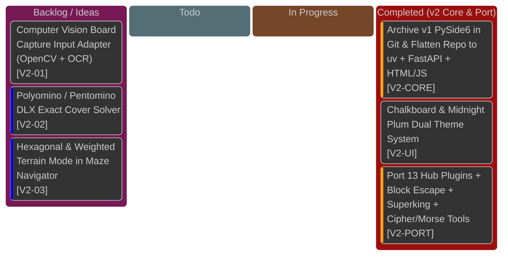

# The Puzzle Law v2 — Kanban Board

Project tracker for **The Puzzle Law** (`app/main.py` + `solvers/*.py` + `web/`).  
*(v1 PySide6 history is archived on branch `legacy/pyside6` / tag `v1-pyside6`.)*

## Notes
- **V2-01 (CV Board Capture):** Planned as a pure input adapter (`POST /api/import/image/{slug}`) returning a JSON state matching the target solver's preset schema.
- **V2-02 (DLX Tiling):** Extend `solvers/packing_grids.py` or add `solvers/polyomino_dlx.py` using the single-file solver contract.
