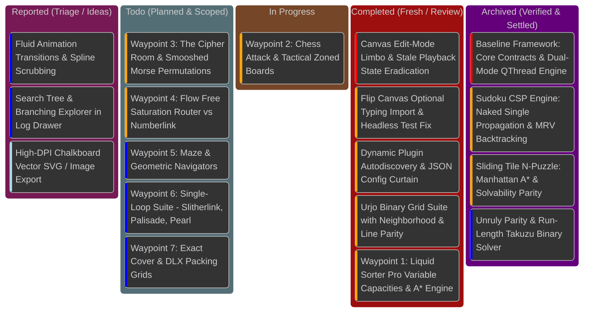

# 📋 The Puzzle Law Task Board & Bug Tracker

Task board, engineering specifications, and architectural bug tracker for **The Puzzle Law (`solvertools_hub`)** ([`solvertools_hub/main.py`](file:///c:/Users/AlitheiaDeus/DeusLocker/L2C/The_Puzzle_Law/solvertools_hub/main.py)).

---

## 📊 Kanban Board

### 🏷️ Board Conventions & Lifecycle Guide

* **Priority Levels**:
  * `'Very High'`: Critical crash, solver lockup, or fundamental state/canvas contract violation.
  * `'High'`: Flagship puzzle engine implementation, core algorithmic milestone, or major UI sync flaw.
  * `'Low'`: Heuristic refinements, additional presets, ergonomic canvas tools, or theme enhancements.
  * `'Very Low'`: Housekeeping, minor styling tweaks, or static asset exports.
* **When to Move / Trash Cards**:
  1. **Fresh Observation**: Tasks stay in `Completed (Fresh / Review)` while manual transcription and transport playback tests are active so any edge-case regressions remain immediately visible.
  2. **Archival**: Once verified across the automated test suite (`tests/test_core_and_plugins.py`) and UI launch verification with zero regressions, move cards into `Archived`.
  3. **Trashing / Pruning**: Because every task, root cause, and technical implementation detail is permanently logged in the **Bug Log & Engineering Specs** table below, visual cards in `Archived` can be pruned or condensed whenever the board exceeds ~7 archived cards.

---

## 🐛 Bug Log & Engineering Specs

| # | Item / Feedback | Category | Status | Root Cause & Engineering Solution |
|---|---|---|---|---|
| **0** | **Baseline Framework: Core Contracts & Dual-Mode Engine** | Core / Architecture | **Done** | **Architecture Design & Implementation**: Established decoupled modular architecture in [`solvertools_hub/core/`](file:///c:/Users/AlitheiaDeus/DeusLocker/L2C/The_Puzzle_Law/solvertools_hub/core/): 1. **`BasePuzzleState`**: Abstract state contract requiring `serialize()`, `deserialize()`, `clone()`, and `validate()`. 2. **`BaseSolver`**: Generator-based solver contract (`solve(initial_state)` yielding `SolverStep`) supporting dual-mode execution: **Playback Mode** (scrubbable timeline steps with highlights and metrics) and **Instant Mode** (tight headless loop yielding optimal path). 3. **`BasePuzzleCanvas`**: Custom `QPainter` canvas supporting `InteractionMode.EDIT` (interactive mouse/keyboard transcription) and `InteractionMode.PLAYBACK` (locked visual stepping). 4. **`SolverWorkerThread`**: Dedicated `QThread` execution engine with cooperative cancellation (`should_abort()`) preserving 60 FPS UI responsiveness. 5. **UI & Theme**: `ChalkTheme` design system ([`theme.py`](file:///c:/Users/AlitheiaDeus/DeusLocker/L2C/The_Puzzle_Law/solvertools_hub/theme.py)) pairing `#0F1412` chalkboard slate with glowing neon accents (`#00F5D4`, `#B5FF4D`, `#FF4D80`), unified `TransportBar`, and collapsible `LogDrawer`. |
| **1** | **Canvas Edit-Mode Limbo & Stale Playback State Eradication** | UI / State Flow | **Done** | **Root Cause Found**: Canvases across `SlidingTileCanvas`, `SandTubeCanvas`, `SudokuCanvas`, `FlipCanvas`, and `UnrulyCanvas` initialized `self.current_step = SolverStep(...)` and rendered directly from `self.current_step.state` in `paintEvent()`. When users clicked cells, selected sample presets, changed dimensions, or cleared the board in `EDIT` mode, `self.state` was mutated, but canvases remained frozen in "limbo" rendering the stale initial `current_step`. **Engineering Solution**: (1) Introduced `BasePuzzleCanvas.get_render_state()` which returns `self.state` whenever `mode == InteractionMode.EDIT` or `current_step is None`; (2) Standardized all canvases to initialize `self.current_step: Optional[SolverStep] = None`; (3) Enforced explicit `self.current_step = None` whenever state is mutated via clicks, brush strokes, preset loading, or clear actions, followed by `state_modified.emit()`; (4) Added regression test `test_all_active_canvases_not_stuck_in_limbo` asserting every active canvas renders `self.state` on startup. |
| **2** | **Dynamic Plugin Autodiscovery & JSON Config Curtain** | Core / Registry | **Done** | **Engineering Solution**: Replaced hardcoded plugin lists with dynamic discovery in [`PluginRegistry`](file:///c:/Users/AlitheiaDeus/DeusLocker/L2C/The_Puzzle_Law/solvertools_hub/core/registry.py) via Python reflection (`importlib`, `pkgutil`, `inspect`). Coupled with [`plugins_config.json`](file:///c:/Users/AlitheiaDeus/DeusLocker/L2C/The_Puzzle_Law/solvertools_hub/plugins_config.json) acting as an architectural "curtain": active plugins (`status: "active"`, `enabled: true`) are exposed in the navigation sidebar, while work-in-progress/scaffold plugins (`status: "wip"`, `enabled: false`) are loaded and validated in test suites without cluttering the active user interface. |
| **3** | **Urjo Binary Grid Suite with Neighborhood & Line Parity** | Logic / Binary Grid | **Done** | **Engineering Solution Implemented**: Built full constraint satisfaction and propagation engine for Urjo in [`solvertools_hub/plugins/urjo/`](file:///c:/Users/AlitheiaDeus/DeusLocker/L2C/The_Puzzle_Law/solvertools_hub/plugins/urjo/): 1. **Triple Constraint Model**: (a) Numerical Moore neighborhood clue ($0 \dots 8$ surrounding black cells); (b) Row/column parity (exactly $N/2$ black and $N/2$ white cells); (c) Adjacent line disparity (no two adjacent rows or columns may have identical cell sequences). 2. **Solver Pipeline**: Priority deduction queue checking clue bounds, line capacities, and parity clash avoidance before branching. 3. **Chalkboard Canvas**: Interactive cell cycling (Empty $\rightarrow$ Sky Blue $\rightarrow$ Coral Red $\rightarrow$ Empty), right-click reverse cycling, clue number overlay with green satisfied / red violated indicators, and preset sample boards. |
| **4** | **Flip Canvas Optional Typing Import & Headless Test Fix** | Linear Algebra / Tests | **Done** | **Root Cause Found**: (1) [`FlipCanvas`](file:///c:/Users/AlitheiaDeus/DeusLocker/L2C/The_Puzzle_Law/solvertools_hub/plugins/flip/canvas.py) referenced `Optional[SolverStep]` in type hints without importing `Optional` from `typing`, triggering `NameError` on import in strict environments. (2) Running `unittest` in headless environments failed because Qt widgets instantiated before a `QApplication` instance existed with an offscreen QPA platform. **Fix**: Imported `Optional` in `canvas.py`. In [`tests/test_core_and_plugins.py`](file:///c:/Users/AlitheiaDeus/DeusLocker/L2C/The_Puzzle_Law/tests/test_core_and_plugins.py), injected `os.environ["QT_QPA_PLATFORM"] = "offscreen"` and initialized a singleton `QApplication` instance prior to test execution. Solves matrix toggle states via Gaussian elimination over $\mathbb{F}_2$. |
| **5** | **Sudoku CSP Engine: Naked Single Propagation & MRV Backtracking** | Constraint Grids | **Done** | **Engineering Solution**: Implemented generalized constraint satisfaction engine in [`solvertools_hub/plugins/sudoku/`](file:///c:/Users/AlitheiaDeus/DeusLocker/L2C/The_Puzzle_Law/solvertools_hub/plugins/sudoku/): supports standard $9\times9$ ($3\times3$ boxes) as well as mini $4\times4$ and $6\times6$ grids. Combines Naked Single deterministic deduction, Minimum Remaining Values (MRV) variable ordering, and forward-checking backtracking. Canvas provides tactile keyboard digit input, pencil mark helpers, and instant red conflict highlights. |
| **6** | **Sliding Tile N-Puzzle: Manhattan A* & Solvability Parity** | 2D Grid / Search | **Done** | **Engineering Solution**: Implemented $N$-puzzle engine in [`solvertools_hub/plugins/sliding_tile/`](file:///c:/Users/AlitheiaDeus/DeusLocker/L2C/The_Puzzle_Law/solvertools_hub/plugins/sliding_tile/): $A^*$ PriorityQueue search with Manhattan distance + Linear Conflict admissible heuristic. Features permutation inversion-parity validation preventing infinite searches on unsolvable random board transcriptions. Interactive canvas supports tile clicking, directional arrow keys, and solution timeline scrubbing. |
| **7** | **Waypoint 1: Liquid Sorter Pro Variable Capacities & A* Engine** | Vector Containers | **Done** | **Engineering Solution**: Overhauled reference tube solver using the advanced engine in `liquids_puzzle_solver.py` ([`solvertools_hub/plugins/sand_tubes/`](file:///c:/Users/AlitheiaDeus/DeusLocker/L2C/The_Puzzle_Law/solvertools_hub/plugins/sand_tubes/)): 1. **Variable Capacities**: Per-tube capacity support (e.g. `[3, 5, 4, 4, 3]`), dynamic visual bottle scaling proportional to volume, and lip fill badges (`current/max`). 2. **Duplicate/Split Color Rules**: Added `allow_split_colors` flag supporting multi-bottle color distributions. 3. **Homogeneity Heuristic $A^*$**: Pruning contiguous blocks, skipping completed monochrome tubes, suppressing ping-pong pours into empty tubes, and breaking empty-tube branching symmetries. 4. **Canvas Ergonomics**: Slot-level color segment painting, settle gravity animation, pastel palette swatches, and click-to-pour interaction. |
| **8** | **Unruly Parity & Run-Length Takuzu Binary Solver** | Grid / Binary | **Done** | **Engineering Solution**: Implemented binary grid solver in [`solvertools_hub/plugins/unruly/`](file:///c:/Users/AlitheiaDeus/DeusLocker/L2C/The_Puzzle_Law/solvertools_hub/plugins/unruly/) enforcing Takuzu constraints: (1) No three consecutive cells of the same color in any row or column; (2) Exactly $N/2$ cells of each color per line. Features edge equality (`=`) and opposite (`x`) relationship tools, live violation markers, and recursive backtracking with deduction propagation. |
| **9** | **Waypoint 2: Chess Attack & Tactical Zoned Boards** | Tactical / Constraint | **In Progress** | **Engineering Scope & Ongoing Implementation**: Merging `chess_attack_solver.py` and `superking_solver.py` into a unified tactical placement solver in [`solvertools_hub/plugins/chess_attack/`](file:///c:/Users/AlitheiaDeus/DeusLocker/L2C/The_Puzzle_Law/solvertools_hub/plugins/chess_attack/): 1. **Piece Taxonomy**: Queen (orthogonal + diagonal rays), Extended King / Promoted Rook (Rook rays + King 1-steps), Super King (Extended King + Knight leaper jumps), and custom $5\times5$ interactive attack offset matrix. 2. **Territorial Zoned Boards**: Arbitrary contiguous zone painting with 1 piece per zone constraint. 3. **Hybrid MRV Solver**: Threat heatmap generation, deterministic zone/row/column overlap deductions, and unattacked candidate search. Scaffold complete; wiring engine algorithms. |
| **10** | **Waypoint 3: The Cipher Room & Smooshed Morse Permutations** | Crypt & Signal | **Todo** | **Engineering Scope**: Porting unspaced Morse beam-search decoder from `Snippets To Integrate/ascii_morse/` to [`solvertools_hub/plugins/cipher_room/`](file:///c:/Users/AlitheiaDeus/DeusLocker/L2C/The_Puzzle_Law/solvertools_hub/plugins/cipher_room/): trie indexing of ~16,400 English words (ENABLE1 + Google Web 1T), unigram log-probabilities, single-letter noise filtering ('A'/'I'), dot/dash inversion/reversal, and multilingual lexicons (EN, DE, FR, ES, RU Cyrillic, JA Wabun). Bundling Caesar $\chi^2$ scoring and monoalphabetic frequency analysis tables. |
| **11** | **Waypoint 4: Flow Free Saturation Router vs. Numberlink** | Paths / Topological | **Todo** | **Engineering Scope**: Porting `flow_solver.py` into [`solvertools_hub/plugins/flow/`](file:///c:/Users/AlitheiaDeus/DeusLocker/L2C/The_Puzzle_Law/solvertools_hub/plugins/flow/): 1. **100% Saturation Routing**: Forced degree-2 gates, corner constraints, and fast flood-fill connected component dead-space rejection. 2. **Numberlink Contrast**: Sparse path routing allowing unvisited grid cells. 3. **Visual Spline Paths**: Rounded `QPainterPath` splines with neon glowing active heads and pastel path conduits. |
| **12** | **Waypoint 5: Maze & Geometric Navigators** | Navigators / Geometry | **Todo** | **Engineering Scope**: Implementing multi-geometry navigation suite in [`solvertools_hub/plugins/maze_navigator/`](file:///c:/Users/AlitheiaDeus/DeusLocker/L2C/The_Puzzle_Law/solvertools_hub/plugins/maze_navigator/): 1. **2D Orthogonal Grid**: Chalk wall painting, Start/Goal markers, $A^*$ (Manhattan), BFS, Dijkstra, and Bidirectional $A^*$. 2. **Hexagonal Coordinates**: Axial/Cube coordinates $(q, r, s)$ with hex-Manhattan metric $d = (|x| + |y| + |z|)/2$. 3. **Euclidean 2D Navigator**: Continuous plane with user-drawn polygonal obstacles, Visibility Graph construction, and string-pulling continuous path smoothing. |
| **13** | **Waypoint 6: Single-Loop Family (Slitherlink, Palisade, Pearl)** | Loops & Boundaries | **Todo** | **Engineering Scope**: Implementing single-loop deduction suite in [`solvertools_hub/plugins/loop_games/`](file:///c:/Users/AlitheiaDeus/DeusLocker/L2C/The_Puzzle_Law/solvertools_hub/plugins/loop_games/): 1. **Slitherlink / Loopy**: Vertex degree invariants ($0$ or $2$), zero clue X marks, adjacent threes line propagation, and sub-loop prevention. 2. **Palisade**: Territory perimeters and vertex border clue satisfaction. 3. **Masyu (Pearl)**: White pearls (straight through + $90^\circ$ turn in adjacent cell) and black pearls ($90^\circ$ turn inside + 2-cell straight extensions). |
| **14** | **Waypoint 7: Exact Cover & DLX Packing Grids** | Exact Cover & Packing | **Todo** | **Engineering Scope**: Porting and building exact cover solvers in [`solvertools_hub/plugins/packing_grids/`](file:///c:/Users/AlitheiaDeus/DeusLocker/L2C/The_Puzzle_Law/solvertools_hub/plugins/packing_grids/): 1. **Nonograms (Picross)**: 2D line-intersection solver using overlapping candidate bounds and constraint relaxation. 2. **Polyomino Packing**: Pentomino and Tetromino grid tiling modeled as an Exact Cover matrix solved via Knuth's Algorithm X with Dancing Links (DLX). |
| **rep1**| **Fluid Animation Transitions & Spline Scrubbing** | Visuals / Animation | **Reported** | Real-time keyframe interpolation between discrete `SolverStep` states on timeline scrubbing (smooth sliding tile translations and curved liquid pouring streams rather than instantaneous step jumps). |
| **rep2**| **Search Tree & Branching Explorer in Log Drawer** | UI / Telemetry | **Reported** | Collapsible graphical tree view in [`LogDrawer`](file:///c:/Users/AlitheiaDeus/DeusLocker/L2C/The_Puzzle_Law/solvertools_hub/ui/log_drawer.py) visualizing the active search frontier, expanded nodes, pruning cuts, and backtrack branches during solver exploration. |
| **rep3**| **High-DPI Chalkboard Vector SVG / Image Export** | Export / Graphics | **Reported** | Export clean, vector SVG representations or high-resolution PNG snapshots of custom boards and solved states directly to the clipboard or disk for documentation and puzzle sharing. |
